<div align="center">


# Tibrary

**Clean up your files, link your collection, and find missing music.**
</div>

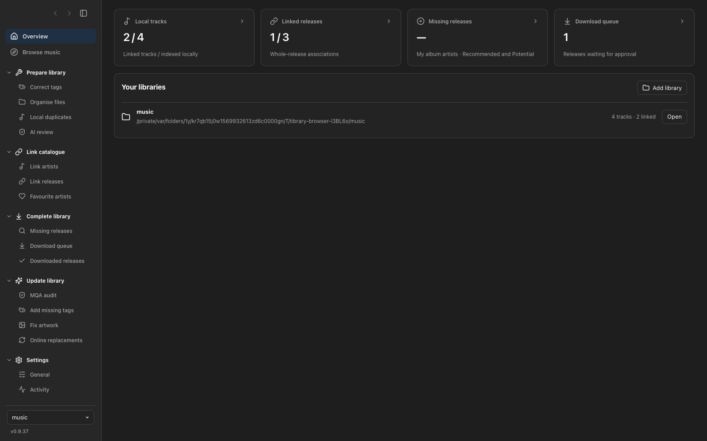

## What it does

- **Prepare your library:** preview tag corrections, organise folders, review local duplicates and flag AI-labelled files for removal.
- **Link your collection:** match album artists, recordings and whole releases using cached catalogue evidence.
- **Browse online music:** explore artists, new releases and playlists, find related tracks, and queue full releases or selected songs.
- **Find missing music:** browse artists, releases and tracks with cached artwork; filter recommendations and queue exactly what you want.
- **Update your files:** fill available tags—including BPM and Camelot keys—improve artwork, and audit MQA files.
- **Follow the work:** one searchable activity log with action filters, saved details and separate cancellation controls for local tasks, online checks and downloads.

## Run on your Mac

Install Xcode Command Line Tools, a current stable [Rust toolchain](https://rustup.rs/), and Node.js LTS. Then, from this repository:

```sh
brew install node ffmpeg
npm --prefix desktop ci
npm --prefix desktop run tauri build -- --bundles app
open desktop/src-tauri/target/release/bundle/macos/Tibrary.app
```

After building, use **Start.command** to reopen the app. Releases contain source code only; binaries are built locally.

For development:

```sh
npm --prefix desktop run tauri dev
```

## Screenshots

Captured from the current UI with a disposable sample library.

| Browse music | Release details |
| --- | --- |
| 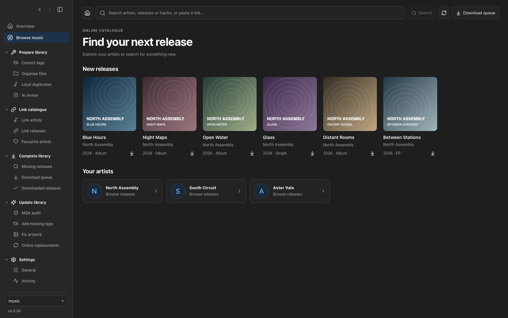 | 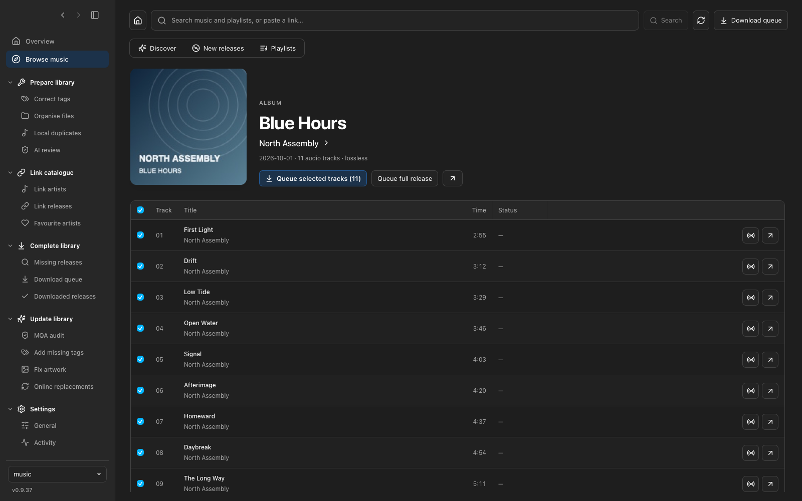 |

| Artist pages | Playlists |
| --- | --- |
| 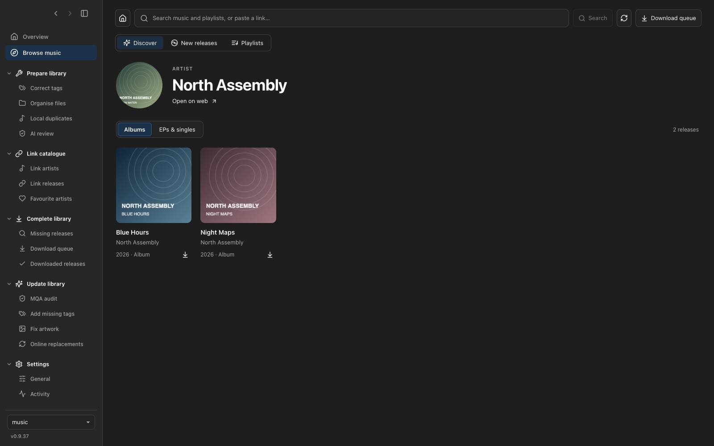 | 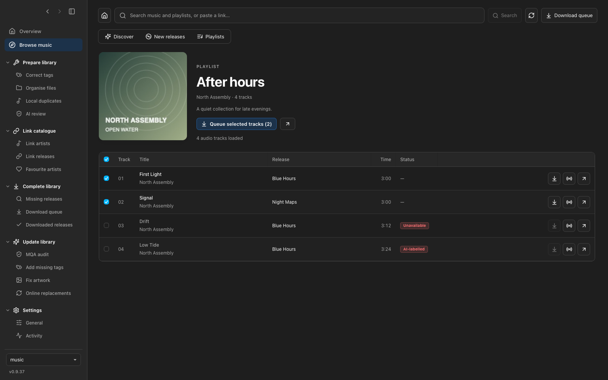 |

| Link releases | Missing releases |
| --- | --- |
| 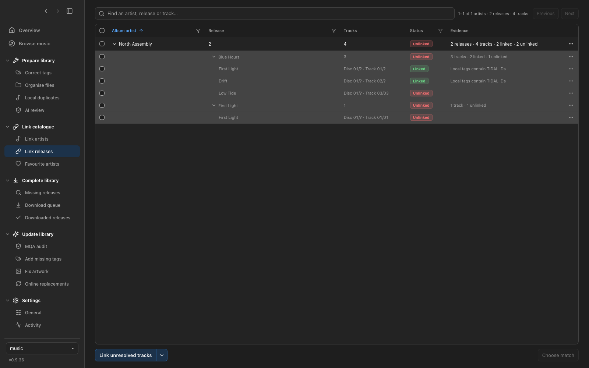 | 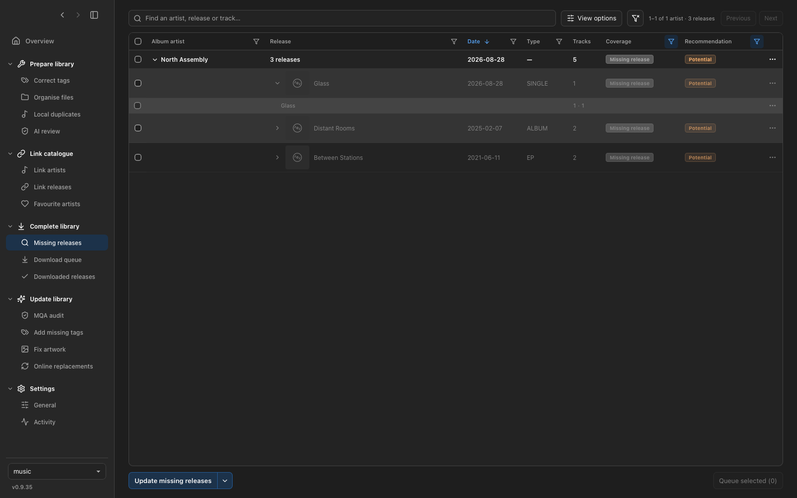 |

| Download queue | Downloaded releases |
| --- | --- |
| 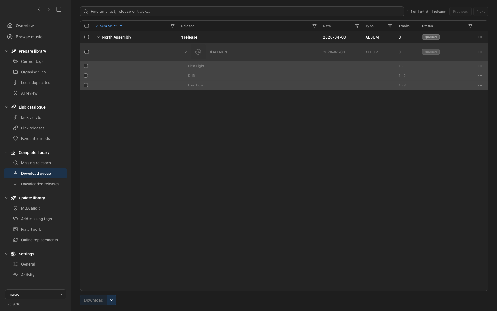 | 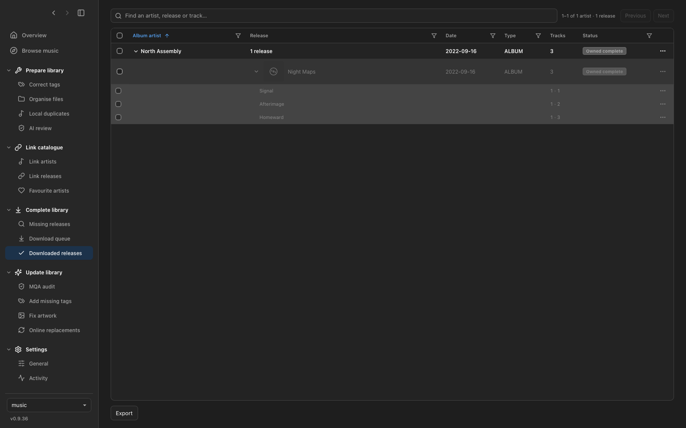 |

| General settings | Activity |
| --- | --- |
| 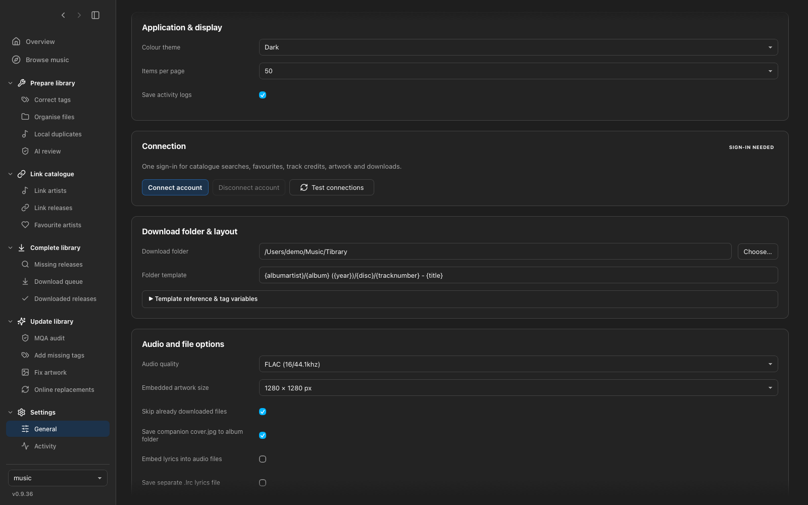 | 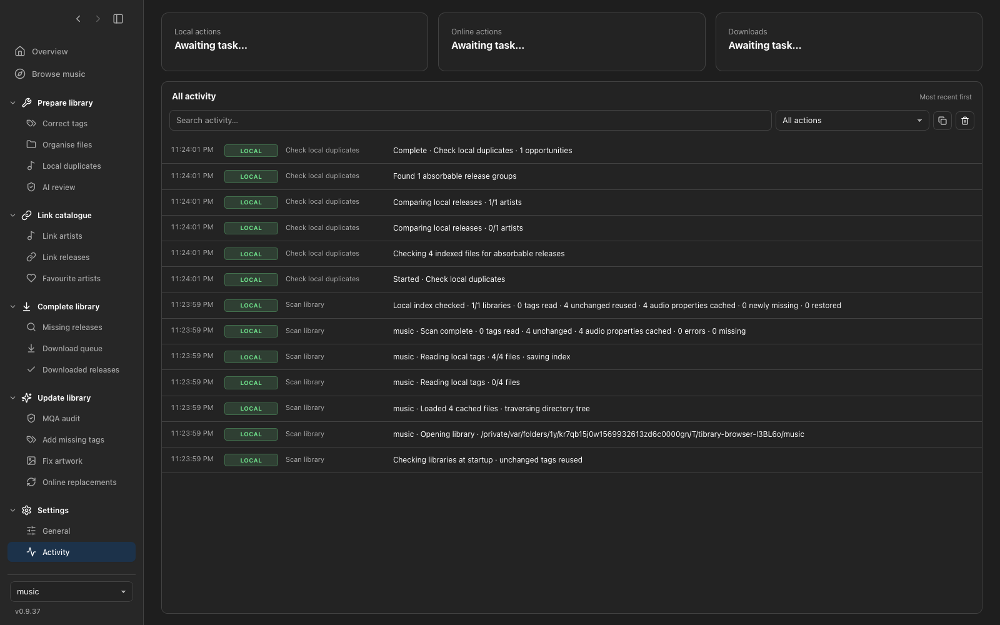 |

Cached libraries remain browsable when their removable drive is disconnected. Online work and downloads to a connected folder remain available; file-changing actions wait for the library drive.

See the [guide](desktop/docs/DOCUMENTATION.md) for workflows and the [release audit](desktop/docs/RELEASE_AUDIT.md) for testing and known limits.

## Credits and licence

Built with [Tauri](https://v2.tauri.app/), [React](https://react.dev/), [Lofty](https://github.com/Serial-ATA/lofty-rs) and [Turso](https://github.com/tursodatabase/turso).

MQA detection references: [AudioAuditor](https://github.com/Angel2mp3/AudioAuditor), [purpl3F0x](https://github.com/purpl3F0x/MQA_identifier) and [Dniel97](https://github.com/Dniel97/MQA-identifier-python).

Subscriber API and download references: [Tidaler](https://github.com/maya-doshi/tidaler) and [Minim](https://minim.readthedocs.io/en/latest/_modules/minim/tidal.html).

Browse-interface inspiration: [Waves](https://github.com/iamprivacy/Waves).

[MIT licence](LICENSE).
